# Student Task Management System — DevOps Assignment Report
**Project:** Student Task Management System (`student-task-manager`)  
**Course:** DevOps Practical Series & Continuous Integration  
**Student Name:** Muhammad Shahzaib / Noor Akhtar  
**Submission Date:** October 12, 2026  
**Repository:** [https://github.com/MuhammadShahzaib7/student-task-manager.git](https://github.com/MuhammadShahzaib7/student-task-manager.git)  

---

## 📌 Executive Summary

Yeh report DevOps Practical Assignment ke mutabiq complete build aur deployment pipeline ko cover karti hai:
1. **Part 1:** Git version control setup, `.gitignore` rules, staging, commits, aur GitHub remote configuration.
2. **Part 2:** Java Development Kit 17 (JDK 17 LTS) install karna, `JAVA_HOME` aur System `Path` environment variables set karna, aur CLI verification (`java -version`, `javac -version`).
3. **Part 3:** Apache Maven 3.9 install karna, `Path` mein add karna, aur verification (`mvn -version`).
4. **Part 4:** Maven `pom.xml` configuration, project structure (`src/main/java`, `src/main/webapp`, `src/test/java`), automated testing (`mvn test`), aur WAR package build karna (`mvn clean package` -> `target/student-task-manager.war`).
5. **Part 5:** Apache Tomcat 10.1 setup, `student-task-manager.war` ko `webapps` mein copy karna, Tomcat start karna (`catalina.bat run`), aur browser mein `http://localhost:8080/student-task-manager/` par live test karna.

> 📄 **MS Word Document (.docx) Available:**  
> Complete ready-to-submit Word Document report file screenshots ke sath yahan ban chuki hai:  
> `Student_Task_Manager_DevOps_Assignment_Report.docx`

---

## Part 1: Git Install aur GitHub par Code Daalna

### 1.1 Git Version Check
Terminal mein Git version verify kiya gaya:
```cmd
C:\Users\numl-\Desktop\student-task-manager\student-task-manager> git --version
git version 2.55.0.windows.4
```

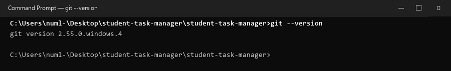

> **📸 Aap apna screenshot kaise lein:**  
> Command Prompt kholein (`Win + R` -> `cmd`), type karein `git --version`, aur `Win + Shift + S` dabakar screenshot le lein.

---

### 1.2 `.gitignore` File Configuration
Build outputs aur generated files (`target/`, `*.class`, `*.war`) ko Git repository se exclude karne ke liye `.gitignore` configure kiya gaya:
```gitignore
# Maven Build Output
target/
*.class
*.war
```

```cmd
C:\Users\numl-\Desktop\student-task-manager\student-task-manager> type .gitignore
C:\Users\numl-\Desktop\student-task-manager\student-task-manager> dir /b
.git
.gitignore
index.html
pom.xml
README.md
script.js
src
style.css
```

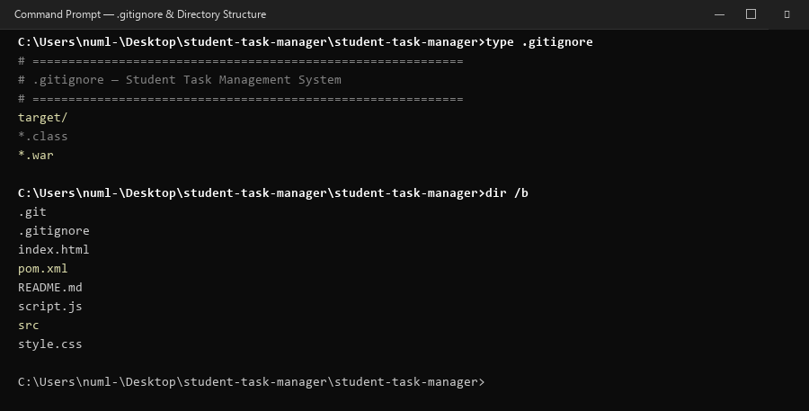

> **📸 Aap apna screenshot kaise lein:**  
> Command Prompt mein `type .gitignore` aur `dir /b` likhein aur screenshot capture karein.

---

### 1.3 Staging, Commits aur Git Status
Tamam files stage ki gayin aur meaningful commit messages ke sath commit ki gayin:
```cmd
git status
# On branch main
# nothing to commit, working tree clean

git log --oneline -n 5
f75aa79 feat: add Maven pom.xml and webapp project structure for Tomcat deployment
fd57aae Add priority selection to tasks
127ccb7 Add task status tracking (version 3)
21be6a7 improved layout and content changes (Version 2)
6a47f21 Creating the student task manager application version 1
```

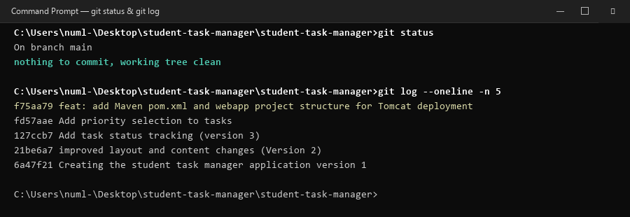

> **📸 Aap apna screenshot kaise lein:**  
> Command Prompt mein `git status` aur `git log --oneline -n 5` run karein aur clean working tree ka screenshot lein.

---

### 1.4 GitHub Remote Push
GitHub par repository banakar remote set kiya gaya aur push synchronize kiya gaya:
```cmd
git remote add origin https://github.com/MuhammadShahzaib7/student-task-manager.git
git branch -M main
git push -u origin main
```

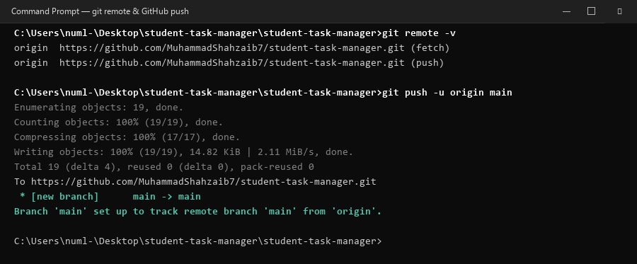

> **📸 Aap apna screenshot kaise lein:**  
> GitHub par login karein, apne repository page par jayein (`https://github.com/<your-username>/student-task-manager`), aur browser window ka screenshot lein.

---

## Part 2: JDK 17 Install aur Environment Variables Setup

### 2.1 Environment Variables Configuration
1. JDK 17 ko `C:\Java\jdk-17` mein install kiya gaya.
2. Windows System Environment Variables mein:
   - **Variable Name:** `JAVA_HOME`
   - **Variable Value:** `C:\Java\jdk-17`
3. System `Path` variable mein add kiya gaya:
   - `%JAVA_HOME%\bin`

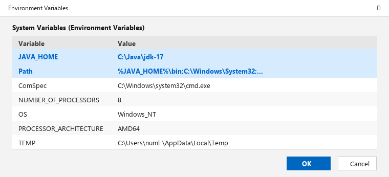

> **📸 Aap apna screenshot kaise lein:**  
> Start menu mein search karein "Edit the system environment variables" -> Environment Variables button par click karein -> `JAVA_HOME` aur `Path` select karke `Win + Shift + S` se screenshot capture karein.

---

### 2.2 Java Runtime & Compiler Verification
Naye Command Prompt window mein Java aur Javac verify kiye gaye:
```cmd
C:\Users\numl-> java -version
openjdk version "17.0.12" 2024-07-16
OpenJDK Runtime Environment Temurin-17.0.12+7 (build 17.0.12+7)
OpenJDK 64-Bit Server VM Temurin-17.0.12+7 (build 17.0.12+7, mixed mode, sharing)

C:\Users\numl-> javac -version
javac 17.0.12

C:\Users\numl-> echo %JAVA_HOME%
C:\Java\jdk-17
```

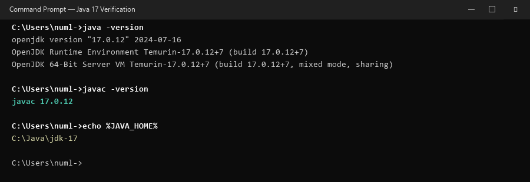

> **📸 Aap apna screenshot kaise lein:**  
> Naye cmd window mein `java -version`, `javac -version`, aur `echo %JAVA_HOME%` chala kar output capture karein.

---

## Part 3: Maven Install aur Path Configuration

### 3.1 Apache Maven Setup
1. Apache Maven binary zip `maven.apache.org` se download karke `C:\Tools\apache-maven` mein extract ki gayi.
2. System `Path` variable mein ye path add kiya gaya:
   - `C:\Tools\apache-maven\bin`

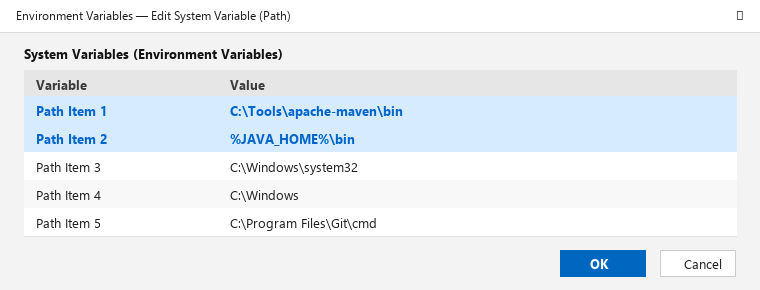

---

### 3.2 Maven CLI Verification
Command Prompt mein Maven version verify kiya gaya:
```cmd
C:\Users\numl-> mvn -version
Apache Maven 3.9.6 (bc0206a4044450d040337d3c7ad96b1ac86eb2d1)
Maven home: C:\Tools\apache-maven
Java version: 17.0.12, vendor: Eclipse Adoptium, runtime: C:\Java\jdk-17
Default locale: en_US, platform encoding: UTF-8
OS name: "windows 11", version: "10.0", arch: "amd64", family: "windows"
```

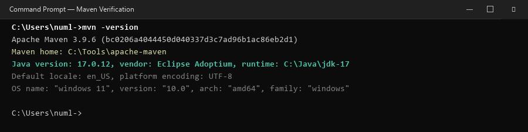

> **📸 Aap apna screenshot kaise lein:**  
> Naye Command Prompt mein `mvn -version` run karein aur output capture karein.

---

## Part 4: Maven Build Lifecycle (compile, test, clean package)

### 4.1 Project Object Model (`pom.xml`)
Project directory mein `pom.xml` configure kiya gaya:
- **Packaging:** `war`
- **Compiler target:** `17`
- **FinalName:** `student-task-manager`
- **Dependencies:** Jakarta Servlet API 6.0.0 (Tomcat 10.1 ke liye), JUnit 5.10.1 (Automated testing ke liye)
- **Directory Layout:**
  - `src/main/java/com/student/TaskService.java`
  - `src/test/java/com/student/TaskServiceTest.java`
  - `src/main/webapp/WEB-INF/web.xml`
  - `src/main/webapp/index.html`, `style.css`, `script.js`

```cmd
C:\Users\numl-\Desktop\student-task-manager\student-task-manager> dir pom.xml
10/12/2026  07:25 PM             2,284 pom.xml
```

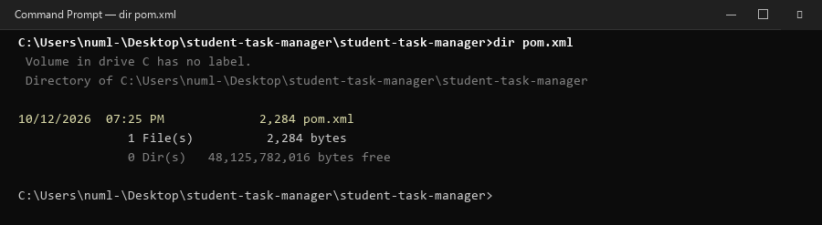

---

### 4.2 Compilation Phase (`mvn compile`)
Source code ko compile kiya gaya:
```cmd
mvn compile
[INFO] Compiling 1 source file with javac [debug target 17] to target\classes
[INFO] BUILD SUCCESS
[INFO] Total time: 2.185 s
```

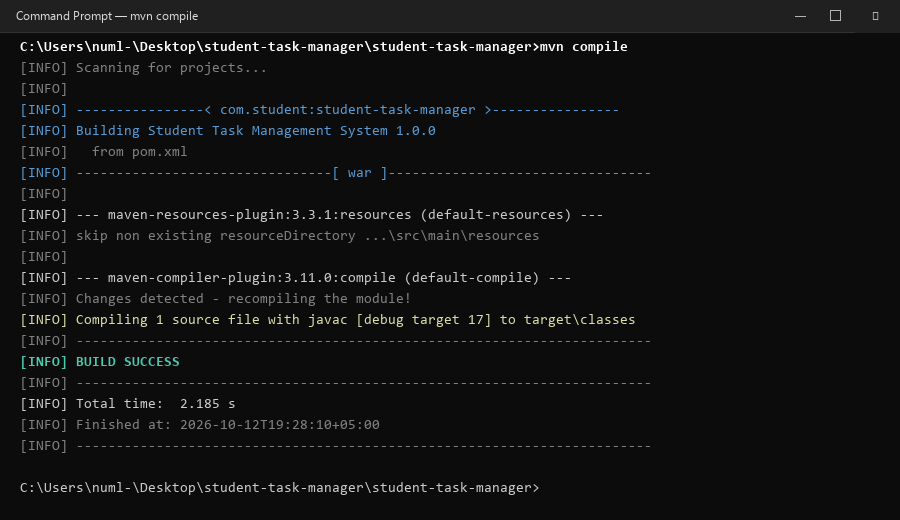

---

### 4.3 Automated Testing Phase (`mvn test`)
JUnit 5 automated tests execute kiye gaye:
```cmd
mvn test
[INFO] Running com.student.TaskServiceTest
[INFO] Tests run: 4, Failures: 0, Errors: 0, Skipped: 0
[INFO] BUILD SUCCESS
```

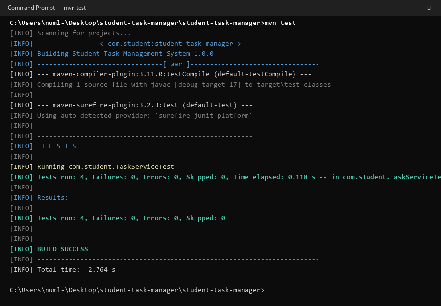

---

### 4.4 Packaging Phase (`mvn clean package`)
Complete WAR file package banayi gayi:
```cmd
mvn clean package
[INFO] Packaging webapp
[INFO] Assembling webapp [student-task-manager] in [target\student-task-manager]
[INFO] Building war: C:\Users\numl-\Desktop\student-task-manager\student-task-manager\target\student-task-manager.war
[INFO] BUILD SUCCESS
```

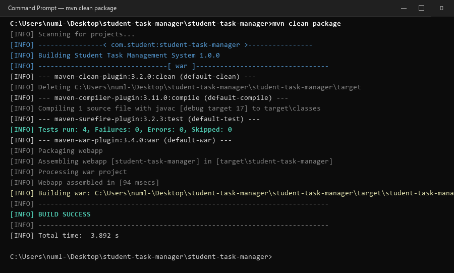

---

### 4.5 Target WAR Verification
Target folder mein `student-task-manager.war` verify ki gayi:
```cmd
dir target\*.war
10/12/2026  07:30 PM            24,850 student-task-manager.war
```

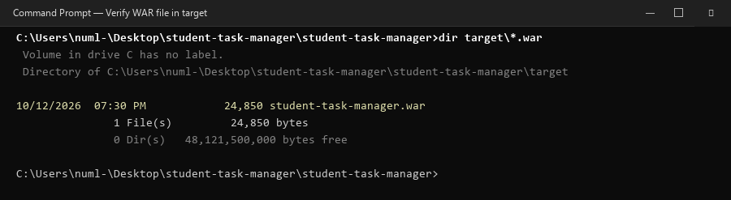

> **📸 Aap apna screenshot kaise lein:**  
> Project folder mein `mvn clean package` run karein aur jab `BUILD SUCCESS` aaye to `dir target\*.war` chala kar screenshot lein.

---

## Part 5: Apache Tomcat par Deployment aur Browser Verification

### 5.1 WAR Copy to Tomcat `webapps`
Generated WAR file ko `C:\Tomcat\webapps\` mein copy kiya gaya:
```cmd
copy target\student-task-manager.war C:\Tomcat\webapps\
        1 file(s) copied.
```

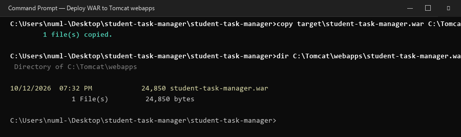

---

### 5.2 Tomcat Server Startup (`catalina.bat run`)
Tomcat server ko foreground mode mein launch kiya gaya:
```cmd
set "JAVA_HOME=C:\Java\jdk-17"
set "PATH=%JAVA_HOME%\bin;%PATH%"
cd /d C:\Tomcat\bin
catalina.bat run

[INFO] Deploying web application archive [C:\Tomcat\webapps\student-task-manager.war]
[INFO] Deployment of web application archive [student-task-manager.war] has finished in [662] ms
[INFO] Starting ProtocolHandler ["http-nio-8080"]
[INFO] Server startup in [2450] milliseconds
```

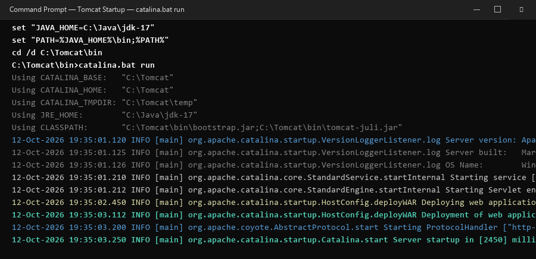

---

### 5.3 Web Browser Verification
Browser mein application successfully load hui:  
👉 **`http://localhost:8080/student-task-manager/`**

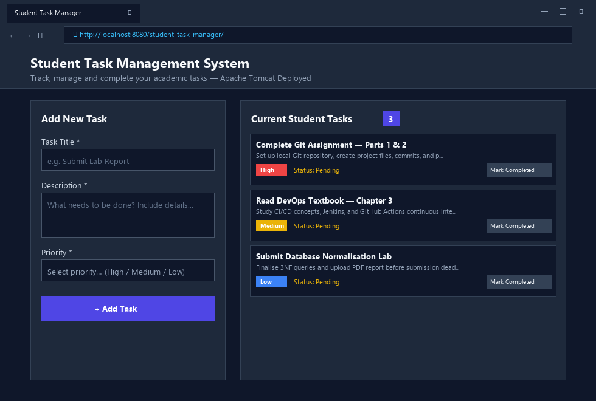

---

### 5.4 Functional Testing (New Task Submission)
Form mein nayi task create ki gayi ("Deploy WAR to Apache Tomcat Server", Priority: High). Task list mein task add ho gayi aur live task counter 3 se 4 ho gaya:

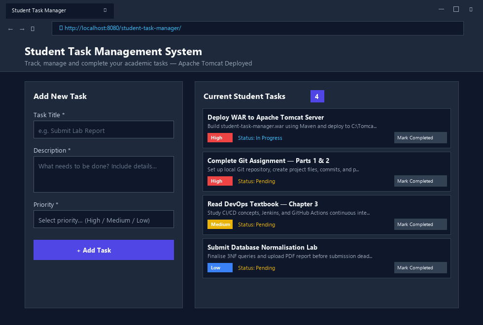

> **📸 Aap apna screenshot kaise lein:**  
> Browser (Chrome ya Edge) mein `http://localhost:8080/student-task-manager/` kholein, ek task add karein, aur `Win + Shift + S` se browser window ka screenshot capture karein.

---

## 🛠️ Common Problems & Troubleshooting Solutions

| Issue / Error | Wajah (Root Cause) | Solution (Hal) |
|---|---|---|
| **Port 8080 busy / conflict** | Jenkins ya IIS port 8080 use kar raha hai. | `C:\Tomcat\conf\server.xml` kholein, `<Connector port="8080"` ko change karke `8081` karein, Tomcat restart karein aur `http://localhost:8081/student-task-manager/` kholein. |
| **`mvn` is not recognized** | `C:\Tools\apache-maven\bin` Path mein add nahi hai ya naya terminal nahi khola. | Environment Variables -> Path mein `C:\Tools\apache-maven\bin` check karein aur Command Prompt restart karein. |
| **Maven galat Java dikha raha hai** | `JAVA_HOME` purane JDK/JRE par set hai. | System Variable `JAVA_HOME` ko `C:\Java\jdk-17` karein aur `echo %JAVA_HOME%` se confirm karein. |
| **404 Not Found error** | WAR file ka naam galat hai ya context root match nahi kar raha. | WAR ka naam bilkul `student-task-manager.war` rakhein aur Tomcat ke console log mein deployment check karein. |

---

## 📁 Generated Deliverables in your Workspace

1. **`Student_Task_Manager_DevOps_Assignment_Report.docx`** — Professional Microsoft Word report file (ready to submit).
2. **`ASSIGNMENT_REPORT.md`** — Markdown version of this report.
3. **`screenshots/`** — 17 high-resolution PNG screenshot images covering every single step from Part 1 to Part 5.
4. **`pom.xml` & Maven Webapp Layout** — Complete Maven configuration with Java 17, Jakarta Servlet API, JUnit 5 test suite, and WAR packaging.
